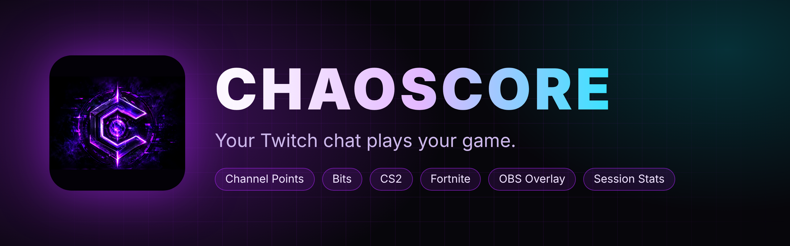
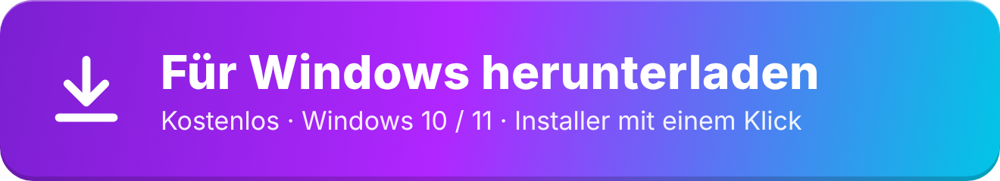
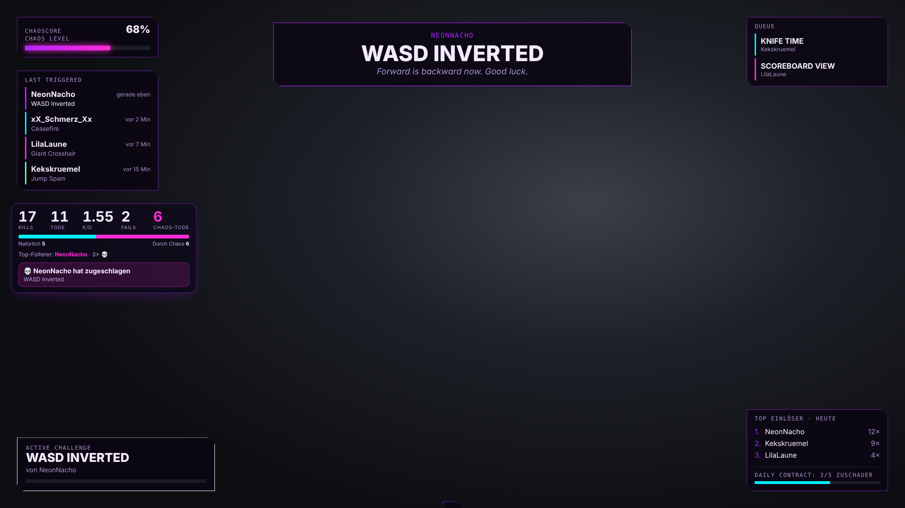
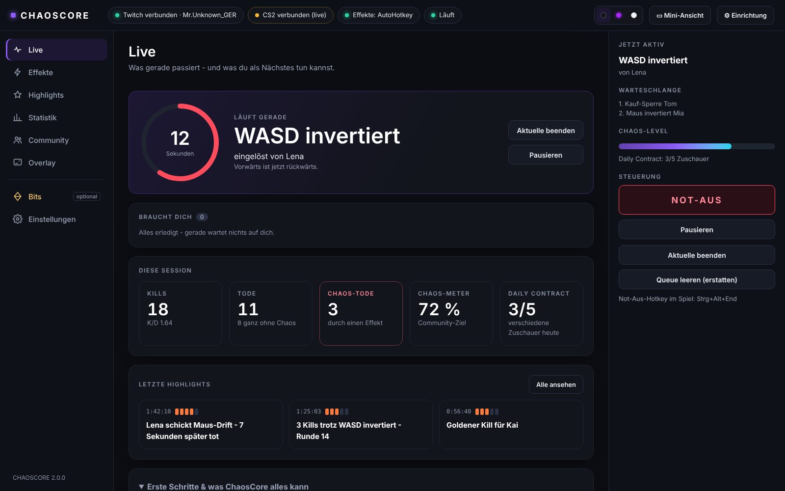
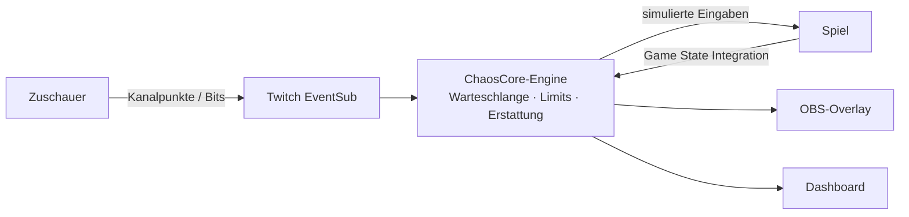

<p align="center">
  
</p>

<!-- download:start (updated automatically by the release workflow) -->
<p align="center">
  <a href="https://github.com/Oliverwebdev/ChaosCore/releases/download/v1.0.0-beta.1/ChaosCore-1.0.0-beta.1-Setup.exe"></a>
  <br>
  <sub><b>v1.0.0-beta.1</b> · <a href="https://github.com/Oliverwebdev/ChaosCore/releases/download/v1.0.0-beta.1/ChaosCore-1.0.0-beta.1-Setup.exe">Setup.exe</a> · <a href="https://github.com/Oliverwebdev/ChaosCore/releases/download/v1.0.0-beta.1/ChaosCore-1.0.0-beta.1-portable.zip">portable ZIP (ohne Installation)</a> · <a href="https://github.com/Oliverwebdev/ChaosCore/releases">alle Versionen</a></sub>
</p>
<!-- download:end -->

<p align="center">
  <a href="https://github.com/Oliverwebdev/ChaosCore/releases"></a>
  <a href="https://github.com/Oliverwebdev/ChaosCore/actions/workflows/tests.yml"></a>
  
  <a href="LICENSE"></a>
</p>

<p align="center">
  <a href="README.md">English</a> · <b>Deutsch</b>
</p>

---

**ChaosCore macht deine Zuschauer zum unberechenbarsten Teammate, das du je hattest.**
Sie geben Twitch-**Kanalpunkte** oder **Bits** aus, und in deinem Spiel passiert etwas — *live*:
WASD dreht sich um, dein Fadenkreuz wird so groß wie eine Wand, du darfst nur noch das Messer
halten. Und wenn du deswegen stirbst, merkt sich ChaosCore, **wer es war**.

Läuft komplett auf deinem PC. Keine Cloud, kein Konto bei uns, kein Stream-Key, kein Speicherzugriff aufs Spiel.

<p align="center">
  
  <br><sub>Das OBS-Overlay im Stream: Alert, Warteschlange, letzte Effekte, Chaos-Level, Top-Einlöser und Session Stats (Beispieldaten).</sub>
</p>

## Warum es ChaosCore gibt

Ich streame CS2 als [Mr.Unknown_GER](https://twitch.tv/mr_unknown_ger). Kanalpunkte enden meistens
als Sound oder Chatzeile — kurz lustig, dann vergessen. Ich wollte, dass meine Zuschauer wirklich
*ins Spiel greifen*: meine Steuerung umdrehen, mir das Gewehr wegnehmen, mich im dümmsten Moment
blenden. Und es sollte hinterher zählen — sterbe ich, weil jemand mein WASD invertiert hat, soll
genau dieser Zuschauer den Kill gutgeschrieben bekommen. Das ist ChaosCore: zuerst für meinen
eigenen Stream gebaut, so gemacht, dass jeder Streamer es in ein paar Minuten einrichten kann.

## Download

Kein Git, keine Befehle — einfach oben auf den großen Download-Knopf klicken.

1. Die `Setup.exe` herunterladen und doppelklicken. Keine Administrator-Rechte, nichts
   nachzuinstallieren — Node.js und AutoHotkey sind dabei.
2. Das Einrichtungs-Fenster führt dich in etwa fünf Minuten durch alles (Twitch-App, Anmeldung,
   Spiel, Belohnungen). Jeder Schritt wird geprüft und erklärt.
3. In OBS eine **Browser-Quelle** anlegen: `http://127.0.0.1:7788/overlay`, 1920 × 1080. Fertig.

Lieber ohne Installer? `portable.zip` entpacken und die `.exe` starten.

> **Early Access:** ChaosCore wird aktiv entwickelt (aktuell: **2.0 Beta**). Die CS2-Effekte und
> die Neuerungen von 2.0 sind live in CS2 und OBS unter Windows getestet.
> Rechne mit Ecken und Kanten — [Fehlermeldungen](https://github.com/Oliverwebdev/ChaosCore/issues/new/choose)
> sind sehr willkommen. Windows SmartScreen kann warnen, weil der Installer noch nicht signiert ist.

## Neu in 2.0

- **Ein neues Dashboard für jeden Bildschirm.** Acht klare Bereiche (Live, Effekte, Highlights,
  Statistik, Community, Overlay, Bits, Einstellungen) und ein Live-Feld mit Not-Aus, das immer
  sichtbar bleibt — vom schmalen OBS-Dock bis zum Ultrawide-Monitor. Drei Designs: Dunkel,
  Unknown, Hell.
- **Live-Cockpit.** Ring mit der Restzeit des laufenden Effekts und ein Postfach „Braucht dich“,
  das nur zeigt, was eine Handlung braucht — jeweils mit dem passenden Knopf.
- **Overlay-Bühne.** Das Overlay über einem CS2-Bild mit markierten Anzeigen (Radar, Killfeed,
  Leben, Munition) anordnen. ChaosCore warnt, wenn ein Fenster sie verdeckt; die
  Standard-Anordnung lässt sie frei.
- **Bits-Leiter ohne Zufall.** Goldener Kill, Rundentaufe, Goldener Rahmen, Fluch der Runde,
  Boss-Runde, Chaos-Parlament — wer cheert, bekommt genau, was auf der Stufe steht.
- **Highlights als Zeitleiste**, Regeln als Sätze, Clip-Obergrenze pro Stream und die
  OBS-Puffer-Länge direkt aus ChaosCore.
- **ffmpeg per Knopf** für Hochkant-Versionen: wird nur nach Klick geladen, gegen eine fest
  hinterlegte SHA-256-Prüfsumme geprüft und im eigenen ChaosCore-Ordner abgelegt — wieder entfernbar.
- **Fadenkreuz riesig mit jedem Fadenkreuz.** ChaosCore liest dein eigenes Fadenkreuz aus CS2 und
  stellt genau das danach wieder her; Kreis, Punkt und Quadrat werden dafür kurz zum Kreuz.
- **Eigene OBS-Overlays.** Overlays, die OBS als „Lokale Datei“ lädt, dürfen den Live-Datenstrom
  (`/events`) mitlesen; normale Webseiten weiterhin nicht.
- **Erst-Test in echtem CS2.** Schritt-für-Schritt-Liste vom Offline-Spiel mit Bots bis zum
  offiziellen Casual.
- **Nur noch CS2.** Alles ist jetzt auf CS2 ausgerichtet.

Alle Änderungen: [`CHANGELOG.md`](CHANGELOG.md).

## Was es kann

| | |
|---|---|
| **Echte Effekte im Spiel** | 23 fertige CS2-Effekte (WASD invertiert, Feuerpause, Knife Time, Fadenkreuz riesig, Maus invertiert, Utility-Steuer, Kauf-Sperre, …). Fadenkreuz-Effekte funktionieren mit jedem Fadenkreuz und stellen immer dein eigenes wieder her. |
| **Kanalpunkte *und* Bits** | Für jeden Kanal nutzbar, seit Twitch im Mai 2026 [Monetarisierung für alle](https://blog.twitch.tv/en/2026/05/13/monetization-for-all/) geöffnet hat — kein Affiliate nötig. |
| **Bits-Leiter — optional, nie Zufall** | Kleine Bits, goldene Momente: *Goldener Kill* (dein nächster Kill wird dem Zuschauer gewidmet), *Rundentaufe*, *Goldener Rahmen*, *Fluch der Runde*, *Boss-Runde* und das *Chaos-Parlament*, in dem der Chat abstimmt. Wer cheert, bekommt genau, was auf der Stufe steht — kein Zufall, keine Wetten. |
| **Bits-Menü: 100 Bits = 1 Minute** | Optional: Zuschauer wählen den Effekt per Stichwort im Cheer (`Cheer300 wasd` = 3 Minuten WASD invertiert), pro Minute oder pro Runde. Dazu ein Chaos-Mix in fester Reihenfolge, Mutproben, Gemeinschaftstopf und ein eigenes Bits-Feld im Overlay. Bits haben Vorrang, gehen nie verloren und Kanalpunkte kommen trotzdem regelmäßig dran. |
| **Session Stats** | Kills, Tode, K/D, Fails, Runden und Matches pro Stream — Tode getrennt in *natürlich* und *durch Chaos*. Wer dich erwischt hat, landet in der **Folter-Rangliste**. |
| **Effekt-Baukasten ohne Code** | Bausteine verketten, wiederholen, zufällig wählen — und jeden Effekt (auch die mitgelieferten) bearbeiten, kopieren, testen und als Datei teilen. |
| **Highlights** | Starke Momente werden automatisch erkannt: Stream-Marker, Twitch-Clips (mit Obergrenze pro Stream) und eine Zeitleiste mit eigenen, abwechslungsreichen Titeln für den Schnitt. Optional lokale Clips über OBS — Puffer-Länge direkt aus ChaosCore, dazu eine Hochkant-Version für Shorts mit deinem Logo (ffmpeg per Knopf). |
| **Raid, Follow, Abo, Hype Train** | Lösen auf Wunsch selbst einen Effekt aus — als Begrüßung oder Dankeschön. |
| **OBS & System-Aktionen** | Szene wechseln, Quelle umschalten, Stream mit Countdown beenden oder ein anderes Spiel starten — nur nach Freischaltung, auf Wunsch mit deinem OK. |
| **OBS-Overlay** | Alerts, Warteschlange, Verlauf, Chaos-Level, Community-Ziel, Season-Ranking, Session Stats, goldene Bits-Momente. Anordnen auf einer Bühne, die die CS2-Anzeigen (Radar, Killfeed, Leben, Munition) markiert und warnt, wenn ein Fenster sie verdeckt; jedes Fenster eigenes Design (Dunkel, Hell, Glas, eigene Farben). Auch eigene Overlay-Dateien können den Live-Datenstrom lesen. |
| **Ein Dashboard für jeden Bildschirm** | Acht klare Bereiche und ein Live-Feld mit Not-Aus — vom schmalen OBS-Dock bis zum Ultrawide-Monitor. Einstellungen als Fragen, Effekte als durchsuchbare Galerie. |
| **Erst-Test in echtem CS2** | Eine Schritt-für-Schritt-Liste vom Offline-Spiel mit Bots bis zum offiziellen Casual — damit du weißt, dass alles klappt, bevor du live gehst. |
| **Mini-Ansicht & Updates per Klick** | Kleine Ansicht mit der Warteliste im Fokus zum Danebenlegen, und Updates direkt von GitHub — geprüft und mit einem Klick installiert. |
| **Community** | Community-Ziel mit Schwellen, Seasons über mehrere Streams mit Chaos-Score, Daily Contract, Auto-Lebendig, Chat-Befehle. |
| **Presets teilen** | Dein ganzes Setup (Tasten, Effekte, Layout, sogar eigene Sounds/Bilder) als eine Datei — mit Vorschau vor jedem Import. |
| **Deutsch & Englisch** | Einrichtung, Dashboard, Overlay und Chat-Meldungen. |

<p align="center">
  
  <br><sub>Das Dashboard in 2.0: laufender Effekt mit Restzeit, Zahlen der Session, letzte Highlights und das Live-Feld mit Not-Aus (Beispieldaten).</sub>
</p>

## Sicher im Stream

- **Feste Effektliste.** Zuschauer wählen nur, was *du* eingerichtet hast — nie Konsolenbefehle aus dem Chat.
- **Eingaben nur ins Spiel.** Der Fokus wird vor jeder einzelnen Eingabe geprüft. Wechselst du
  mitten im Effekt das Fenster, bricht er sofort ab und alle Tasten werden losgelassen.
- **Not-Aus** im Dashboard und per Hotkey `Strg+Alt+Ende`.
- **Warteschlange, Cooldowns, Limits pro Zuschauer.** Ungültige Einlösungen werden automatisch mit Begründung erstattet.
- **Gehärteter Preset-Import.** Fremde Presets können weder Windows-/Enter-/Escape-/Alt-Tasten
  nutzen noch Fokusprüfung oder Not-Aus ändern; eine fehlerhafte Datei wird komplett abgelehnt.
- **Nur lokal.** Der Server hört nur auf `127.0.0.1`, Tokens bleiben in deinem Datenordner, und der
  Fehlerbericht wird nie automatisch verschickt.

> **Eigenverantwortung:** ChaosCore simuliert Tastatur- und Mauseingaben wie ein Makro. Ob ein
> Anti-Cheat-System darauf reagiert, kann sich jederzeit ändern und liegt außerhalb von ChaosCore.
> Nutzung auf eigenes Risiko: Nutze nur Effekte ohne Vorteil im Spiel und prüfe die aktuellen Regeln
> des Spiels und von Twitch. ChaosCore lässt dich das beim ersten Start einmal bestätigen.

## So funktioniert's



ChaosCore ist ein kleiner lokaler Node.js-Server. Er empfängt Twitch EventSub, schickt Effekte
über AutoHotkey ins Spielfenster, liest den Spielzustand über Valves offizielle Game State
Integration (CS2, kein Speicherzugriff) und liefert Dashboard und Overlay an Browser und OBS.

## Aus dem Quellcode bauen

Benötigt Node.js ≥ 22.13 (nutzt das eingebaute `node:sqlite`; keine npm-Abhängigkeiten).

```bash
git clone https://github.com/Oliverwebdev/ChaosCore.git
cd ChaosCore
npm run setup     # geführte Einrichtung im Terminal
npm start         # Server starten
npm test          # kompletter Selbsttest gegen simuliertes Twitch (~4 Min.)
```

Der Windows-Installer wird unter Linux/WSL mit `npm run build:win` gebaut
(braucht `gcc-mingw-w64-x86-64-win32`, `nsis`, `zip`, `unzip`, `python3-pil`).

Schnellstart: [`docs/ANLEITUNG.md`](docs/ANLEITUNG.md) · Alle Funktionen und Einstellungen:
[`docs/HANDBUCH.md`](docs/HANDBUCH.md).

## Stand & Roadmap

- [x] CS2-Profil mit 23 Effekten, Bits-Stufen, Overlay, Dashboard, Presets, Seasons, Community-Ziel
- [x] Session Stats mit Chaos-Tod-Zuordnung (Beta)
- [x] Bits-Menü, Mini-Ansicht, eigenes Design je Overlay-Fenster, Updates per Klick (Beta)
- [x] 1.2: Effekt-Editor, Bits-Ausbau, Highlights & Clips, Raid/Follow/Abo/Hype Train, OBS & System-Aktionen, signierte Updates
- [x] 2.0 (Beta): Fokus auf CS2, neues Dashboard für jede Bildschirmgröße, Overlay-Bühne mit CS2-Anzeigen, Bits-Leiter ohne Zufall, Erst-Test-Checkliste
- [ ] Praxistests auf Windows in echten Streams
- [ ] Signierter Installer

Den Fortschritt siehst du unter [Releases](https://github.com/Oliverwebdev/ChaosCore/releases) und im Commit-Verlauf.

## Mitmachen

Ideen, Fehlermeldungen und Pull Requests sind willkommen — siehe [CONTRIBUTING.md](CONTRIBUTING.md).
Sicherheitslücke gefunden? Bitte zuerst [SECURITY.md](SECURITY.md) lesen.

## Lizenz

ChaosCore ist freie Software unter der [GNU General Public License v3.0](LICENSE) oder neuer.
Mitgelieferte Fremdsoftware (Node.js, AutoHotkey) behält ihre eigenen Lizenzen — siehe
[THIRD-PARTY-LICENSES.md](THIRD-PARTY-LICENSES.md).

Gemacht von [WebDevOli](https://github.com/Oliverwebdev) · live auf Twitch als
[Mr.Unknown_GER](https://twitch.tv/mr_unknown_ger).

<sub>ChaosCore ist nicht mit Twitch oder Valve verbunden. Twitch ist eine Marke von
Twitch Interactive, Inc. Counter-Strike und CS2 sind Marken der Valve Corporation.</sub>
