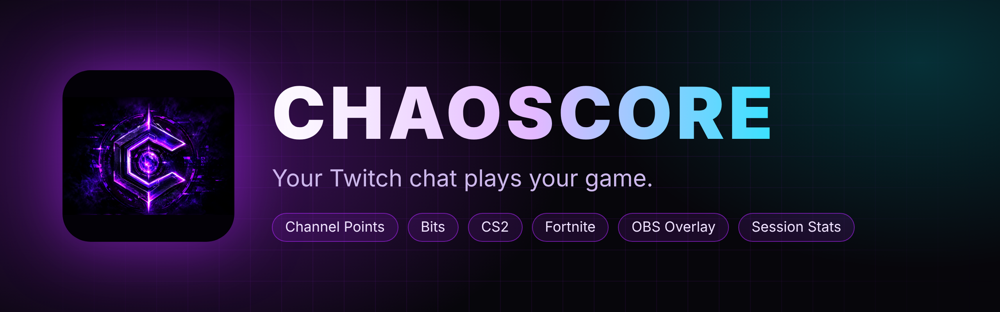
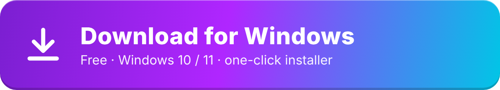
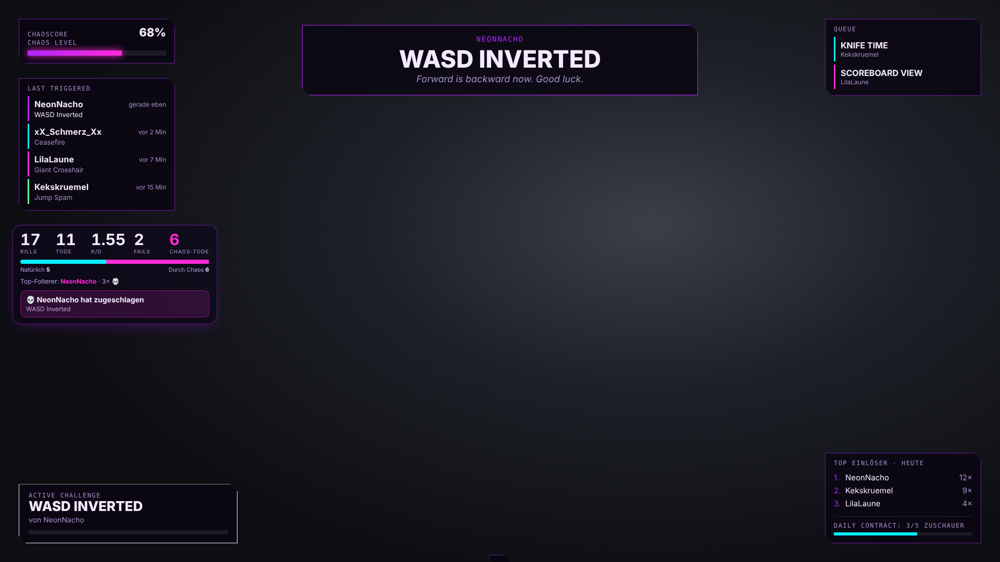
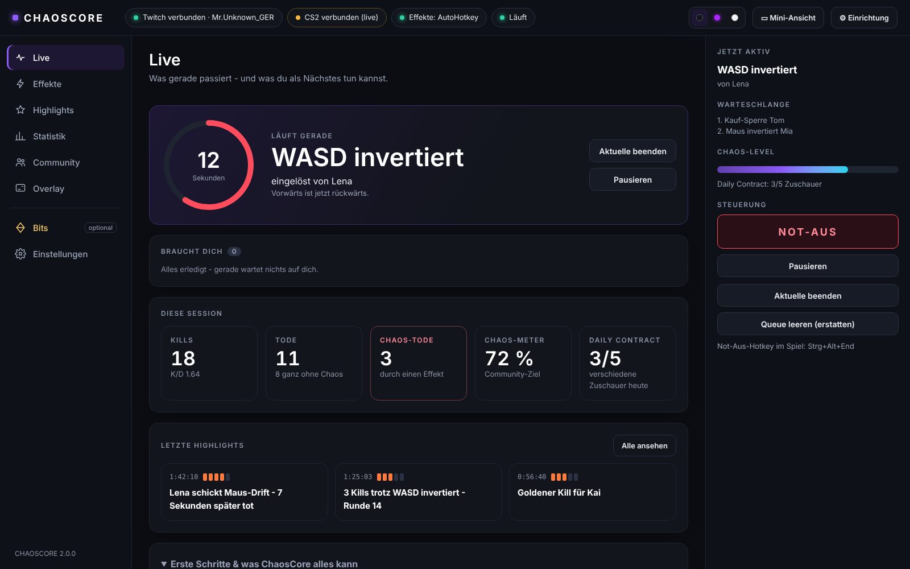
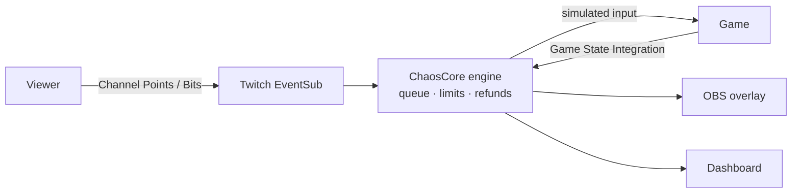

<p align="center">
  
</p>

<!-- download:start (updated automatically by the release workflow) -->
<p align="center">
  <a href="https://github.com/Oliverwebdev/ChaosCore/releases/download/v2.0.0-beta.1/ChaosCore-2.0.0-beta.1-Setup.exe"></a>
  <br>
  <sub><b>v2.0.0-beta.1</b> · <a href="https://github.com/Oliverwebdev/ChaosCore/releases/download/v2.0.0-beta.1/ChaosCore-2.0.0-beta.1-Setup.exe">Setup.exe</a> · <a href="https://github.com/Oliverwebdev/ChaosCore/releases/download/v2.0.0-beta.1/ChaosCore-2.0.0-beta.1-portable.zip">portable ZIP (no install)</a> · <a href="https://github.com/Oliverwebdev/ChaosCore/releases">all versions</a></sub>
</p>
<!-- download:end -->

<p align="center">
  <a href="https://github.com/Oliverwebdev/ChaosCore/releases"></a>
  <a href="https://github.com/Oliverwebdev/ChaosCore/actions/workflows/tests.yml"></a>
  
  <a href="LICENSE"></a>
</p>

<p align="center">
  <b>English</b> · <a href="README.de.md">Deutsch</a>
</p>

---

**ChaosCore turns your viewers into the most unpredictable teammate you've ever had.**
They spend Twitch **Channel Points** or **Bits**, and something happens in your game — *live*:
your WASD flips, your crosshair grows to the size of a wall, your knife is the only thing you're
allowed to hold. And when you die because of it, ChaosCore remembers **who did it**.

Runs entirely on your PC. No cloud, no account with us, no stream key, no memory hacking.

<p align="center">
  
  <br><sub>The OBS overlay mid-stream: alert, queue, recent effects, chaos meter, top redeemers and live session stats (example data).</sub>
</p>

## Why I built this

I stream CS2 as [Mr.Unknown_GER](https://twitch.tv/mr_unknown_ger). Channel points usually end up
as a sound or a line in chat — fun for a second, then forgotten. I wanted my viewers to actually
*reach into the game*: flip my controls, take my rifle away, blind me at the worst moment. And I
wanted it to matter afterwards — when I die because someone inverted my WASD, that viewer should
get the credit (and the bragging rights). That's ChaosCore: built for my own stream first, made
so any streamer can set it up in a few minutes.

## Download

No Git, no commands — just click the big download button at the top.

1. Download the `Setup.exe` and double-click it. No admin rights, nothing else to install —
   Node.js and AutoHotkey are bundled.
2. The setup window guides you through everything in about five minutes (Twitch app, login,
   game, rewards). Every step is checked and explained.
3. In OBS add a **Browser Source**: `http://127.0.0.1:7788/overlay`, 1920 × 1080. Done.

Prefer no installer? Grab the `portable.zip`, unzip it and start the `.exe`.

> **Early access:** ChaosCore is in active development (current: **2.0 beta**). The CS2 effects
> and the 2.0 features have been tested live in CS2 and OBS on Windows. Expect rough edges — [bug reports](https://github.com/Oliverwebdev/ChaosCore/issues/new/choose)
> are very welcome. Windows SmartScreen may warn because the installer isn't code-signed yet.

## What's new in 2.1 (in development)

- **Upload clips to YouTube Shorts and TikTok.** Connect each account once with one click; the
  vertical version of a clip goes up only when you press the button — or automatically after the
  stream. YouTube uploads are private by default, TikTok uploads land as drafts in your app.
- **"Clip that!"** — viewers trigger a clip with channel points; no clip possible means points back.
- **Clips that actually happen:** new points for 3/4/5-kill rounds and quick kills, and a readiness
  checklist in the live cockpit that tells you right away when OBS, the replay buffer, ffmpeg or a
  permission is missing.
- **More robust:** OBS and Twitch reconnect by themselves after network drops; the restore safety net
  resets mouse buttons and the complete crosshair, even after a crash.

Details in the [changelog](CHANGELOG.md).

## What's new in 2.0

- **A new dashboard for every screen.** Eight clear areas (Live, Effects, Highlights, Stats,
  Community, Overlay, Bits, Settings) and a live panel with the emergency stop that is always
  visible — from a narrow OBS dock to an ultrawide monitor. Three designs: Dark, Unknown, Light.
- **Live cockpit.** A ring with the time left of the running effect and a *Needs you* inbox that
  only shows what needs an action, each with the right button.
- **Overlay stage.** Arrange the overlay over a CS2 view with the HUD marked (radar, kill feed,
  health, ammo). ChaosCore warns when a window covers it; the default layout keeps the HUD free.
- **Bits ladder without randomness.** Golden Kill, Round Naming, Golden Frame, Round Curse, Boss
  Round, Chaos Parliament — viewers get exactly what the tier says.
- **Highlights timeline** with rules written as sentences, a clip limit per stream, and the OBS
  replay length set from ChaosCore.
- **One-click ffmpeg** for vertical Shorts versions: downloaded only on click, checked against a
  pinned SHA-256 and stored in ChaosCore's own folder — removable again.
- **Huge Crosshair works with every crosshair.** ChaosCore reads your own crosshair from CS2 and
  restores exactly that afterwards; circle, dot and square styles briefly become a cross.
- **Your own OBS overlays.** Overlays loaded as an OBS *local file* can read the live event stream
  (`/events`); regular websites still can't.
- **First test in real CS2.** A step-by-step checklist from offline bots to official Casual.
- **CS2 only.** Everything is now built around CS2.

All changes: [`CHANGELOG.md`](CHANGELOG.md).

## What it does

| | |
|---|---|
| **Real in-game effects** | 23 ready-to-use CS2 effects (WASD Inverted, Ceasefire, Knife Time, Huge Crosshair, Inverted Mouse, Utility Tax, Buy Lock, …). Crosshair effects work with whatever crosshair you use and always restore your own. |
| **Channel Points *and* Bits** | Usable on every channel since Twitch [opened monetization to everyone](https://blog.twitch.tv/en/2026/05/13/monetization-for-all/) in May 2026 — no Affiliate needed. |
| **Bits ladder — optional, never random** | Small Bits, golden moments: *Golden Kill* (your next kill is dedicated to the viewer), *Round Naming*, *Golden Frame*, *Round Curse*, *Boss Round* and the *Chaos Parliament* where chat votes. Viewers always get exactly what the tier says — no randomness, no bets. |
| **Bits menu: 100 Bits = 1 minute** | Optional: viewers pick the effect with a keyword in their cheer (`Cheer300 wasd` = 3 minutes of inverted WASD), per minute or per round. Plus a fixed-order chaos mix, dares, a community pot and its own Bits panel in the overlay. Bits jump the queue, are never lost, and channel points still get their turn. |
| **Session Stats** | Kills, deaths, K/D, fails, rounds and matches per stream — with deaths split into *natural* vs. *caused by chaos*. The viewer who got you lands on the **torture leaderboard**. |
| **No-code effect builder** | Chain, repeat or randomize blocks — and edit, copy, test and share any effect, including the built-in ones. |
| **Highlights** | Strong moments are detected automatically: stream markers, Twitch clips (with a per-stream limit) and a timeline with unique, varied titles for editing. Optional local clips via OBS — replay length set from ChaosCore, plus a vertical version for Shorts with your logo (ffmpeg installs with one click). |
| **Raid, follow, sub, Hype Train** | Can trigger an effect on their own — as a welcome or a thank-you. |
| **OBS & system actions** | Switch scenes, toggle sources, end the stream after a countdown or launch another game — only once unlocked, optionally with your OK. |
| **OBS overlay** | Alerts, queue, history, chaos meter, community goal, season ranking, session stats, golden Bits moments. Arrange it on a stage that marks the CS2 HUD (radar, kill feed, health, ammo) and warns when a window covers it; style every window (dark, light, glass, your own colors). Your own overlay files can read the live event stream too. |
| **A dashboard that fits any screen** | Eight clear areas and a live panel with the emergency stop, from a narrow OBS dock to an ultrawide monitor. Settings are asked as questions, effects are a searchable gallery. |
| **First test in real CS2** | A step-by-step checklist from offline bots to official Casual, so you know it works before you go live. |
| **Mini view & one-click updates** | A small queue-first view to keep next to your game, and updates straight from GitHub — verified and installed with one click. |
| **Community features** | Community goal with thresholds, multi-stream seasons with a chaos score, daily contract, auto-lively mode, chat commands. |
| **Shareable presets** | Export your whole setup (keys, effects, layout, even your own sounds/images) as one file — with a preview before anything is imported. |
| **German & English** | Setup, dashboard, overlay and chat messages. |

<p align="center">
  
  <br><sub>The 2.0 dashboard: running effect with time left, session numbers, latest highlights and the live panel with the emergency stop (example data).</sub>
</p>

## Built to be safe on stream

- **Fixed effect list.** Viewers pick from what *you* configured — never console commands from chat.
- **Input only goes to the game.** Focus is checked before every single input. Alt-tab mid-effect
  and it stops immediately and releases every key.
- **Panic button** in the dashboard and as hotkey `Ctrl+Alt+End`.
- **Queue, cooldowns and per-viewer limits.** Invalid redemptions are refunded automatically, with a reason.
- **Hardened preset import.** Foreign presets can't use Windows/Enter/Escape/Alt keys, can't touch
  focus checks or the panic hotkey, and a faulty file is rejected as a whole.
- **Local only.** The server listens on `127.0.0.1`, tokens stay in your data folder, and the
  diagnostic report is never sent anywhere automatically.

> **Your responsibility:** ChaosCore simulates keyboard and mouse input like a macro. Whether a
> game's anti-cheat reacts to that can change at any time and is outside of ChaosCore's control.
> Use it at your own risk, only use effects that give no in-game advantage, and check the current
> rules of the game and of Twitch. ChaosCore asks you to confirm this once on first start.

## How it works



ChaosCore is a small local Node.js server. It listens to Twitch EventSub, sends effects through
AutoHotkey into the game window, reads the game state via Valve's official Game State Integration
(CS2, no memory access) and serves the dashboard and overlay to your browser and OBS.

## Building from source

Requires Node.js ≥ 22.13 (uses the built-in `node:sqlite`; no npm dependencies).

```bash
git clone https://github.com/Oliverwebdev/ChaosCore.git
cd ChaosCore
npm run setup     # guided setup in the terminal
npm start         # start the server
npm test          # full self-test against a simulated Twitch (~4 min)
```

The Windows installer is built on Linux/WSL with `npm run build:win`
(needs `gcc-mingw-w64-x86-64-win32`, `nsis`, `zip`, `unzip`, `python3-pil`).

Guides (German): quick start in [`docs/ANLEITUNG.md`](docs/ANLEITUNG.md), every feature and setting in [`docs/HANDBUCH.md`](docs/HANDBUCH.md).

## Status & roadmap

- [x] CS2 profile with 23 effects, Bits tiers, overlay, dashboard, presets, seasons, community goal
- [x] Session Stats with chaos-death attribution (beta)
- [x] Bits menu, mini view, per-window overlay styles, one-click updates (beta)
- [x] 1.2: effect editor, Bits expansion, highlights & clips, raid/follow/sub/Hype Train, OBS & system actions, signed updates
- [x] 2.0 (beta): CS2 focus, new dashboard for every screen size, overlay stage with CS2 HUD zones, Bits ladder without randomness, first-test checklist
- [ ] 2.1: uploads to YouTube Shorts & TikTok, "Clip that!" reward, clip readiness checklist, new highlight points
- [ ] Real-world testing on Windows during live streams
- [ ] Code-signed installer

Follow the progress in [Releases](https://github.com/Oliverwebdev/ChaosCore/releases) and the commit history.

## Contributing

Ideas, bug reports and pull requests are welcome — see [CONTRIBUTING.md](CONTRIBUTING.md).
Found a security issue? Please read [SECURITY.md](SECURITY.md) first.

## License

ChaosCore is free software under the [GNU General Public License v3.0](LICENSE) or later.
Bundled third-party software (Node.js, AutoHotkey) keeps its own licenses — see
[THIRD-PARTY-LICENSES.md](THIRD-PARTY-LICENSES.md).

Made by [WebDevOli](https://github.com/Oliverwebdev) · live on Twitch as
[Mr.Unknown_GER](https://twitch.tv/mr_unknown_ger).

<sub>ChaosCore is not affiliated with Twitch or Valve. Twitch is a trademark of Twitch
Interactive, Inc. Counter-Strike and CS2 are trademarks of Valve Corporation.</sub>
